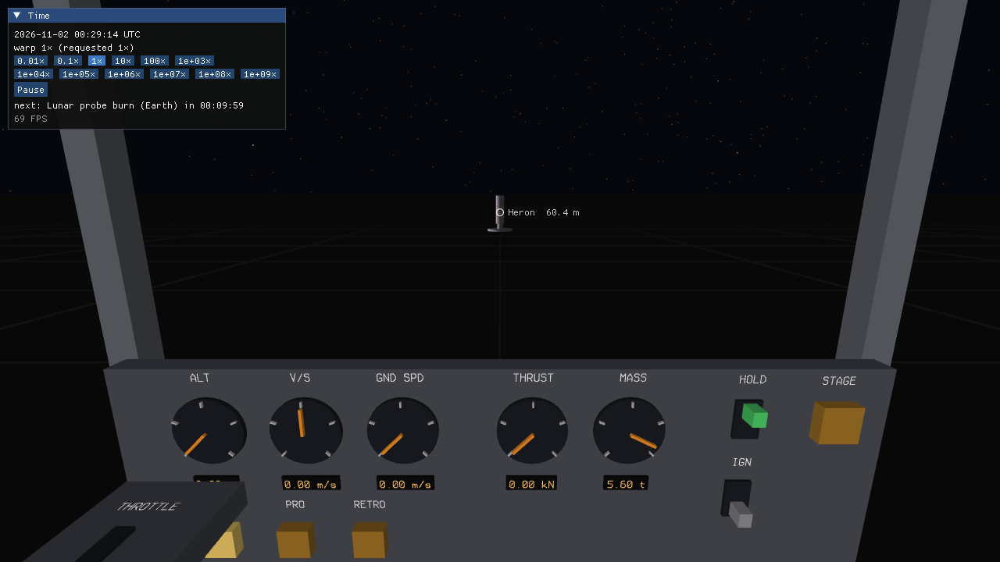
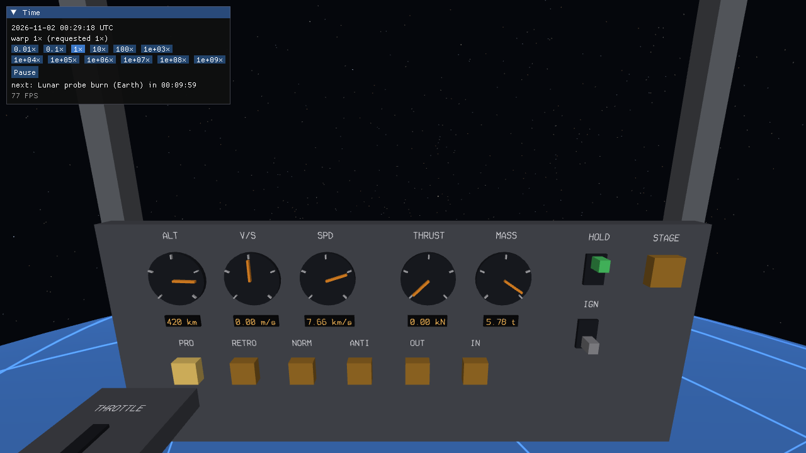
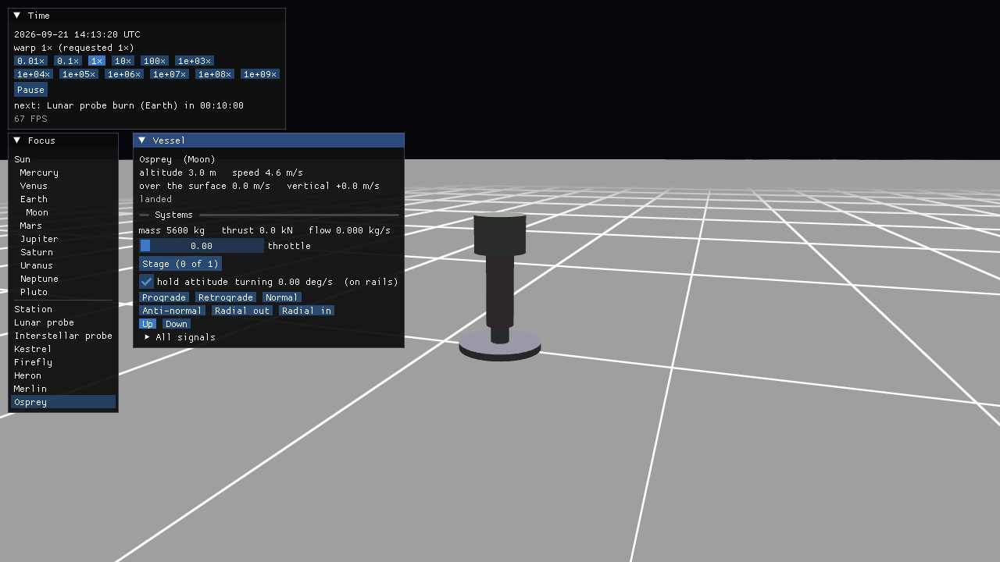
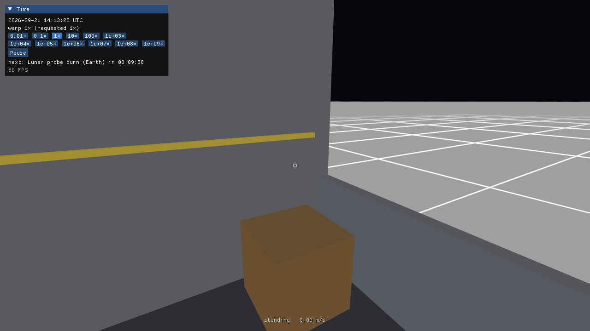
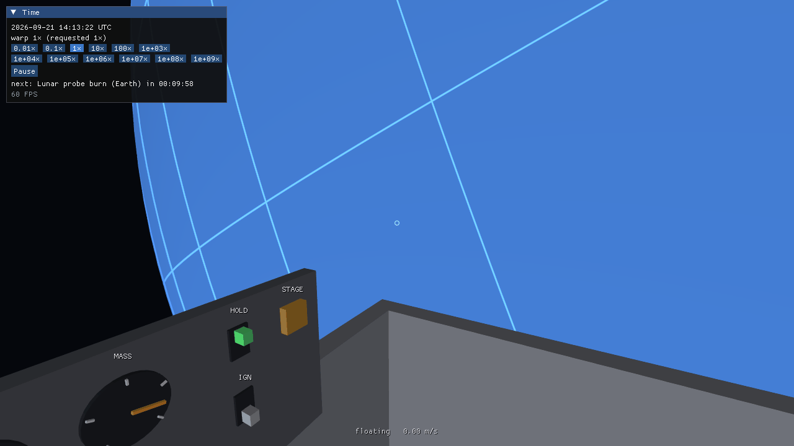
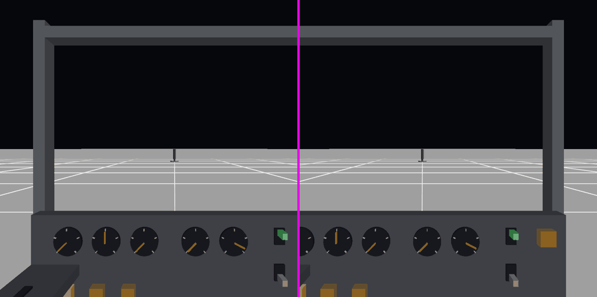

# Flight view (Phase 4)

The vessel being flown, seen from its seat or from outside, with controls that work. Everything
on screen is provisional: there are no models, so parts are cylinders and a cockpit is a few
boxes, and the ground is a smooth sphere with a grid on it. What is not provisional is how it
is put together, which is what a real interior and VR will stand on (BRIEFING §12, D26).

| | |
|---|---|
|  |  |
| *Osprey* on the Moon, from its seat: *Heron* stands 60 m ahead | *Merlin* in a 420 km orbit, the Earth below the floor |



*Osprey from the camera that circles it. The panels of the map view are still there (F2 hides
them).*

## Running it

```sh
./build/client/apps/helios/helios --focus Osprey --view cockpit   # a lander, standing on the Moon
./build/client/apps/helios/helios --focus Merlin --view cockpit   # an orbiter
./build/client/apps/helios/helios --focus Kestrel --view outside  # any vessel made of parts
```

Or start in the map, focus a vessel (click it in the *Focus* panel, or tab) and press `M`.

| Control | |
|---|---|
| `M` | map ↔ flight view |
| `C` | cockpit ↔ outside (a vessel without a seat only has the outside) |
| drag | cockpit: turn the head · outside: circle the vessel |
| wheel | outside: closer / further |
| click, drag on an instrument | throw a switch, press a button, move a lever |
| shift / ctrl | throttle up / down · `Z` full · `X` cut |
| `W` `S` | nose down / up · `A` `D` yaw left / right · `Q` `E` roll left / right |
| enter | next stage · `T` attitude hold on / off |
| F2 | show / hide the *Focus* and *Vessel* panels |
| `F` | whatever the prompt in the picture says: leave the seat, sit down, pick up, let go |
| `P` | pause (space too, except out of the seat) |

The steering keys turn the vessel as the pilot sees it from the seat: in Osprey, whose pilot
faces sideways with the nose overhead, `A` and `D` turn the vessel about its own long axis. They
work the reaction wheels directly and win over the attitude hold while they are down; with
*HOLD* on, the vessel then turns back to where it was pointed, so switch it off to fly by hand.

**A first flight.** `--focus Osprey --view cockpit`. Press *STAGE* (or enter): the engine is
armed, *IGN* goes green. Drag the throttle lever on the console to the left, or hold shift:
above 57 % the lander lifts off. Watch *V/S* and *ALT*; the grid on the ground is 10 m to a
cell near the surface and widens as you climb. Come back down at less than 6 m/s.

## Out of the seat

| | |
|---|---|
|  |  |
| *Petrel* on the Moon: standing in the habitat, looking back at the crate and a window | *Albatross* in orbit: floating by the controls, the Earth outside |

```sh
./build/client/apps/helios/helios --focus Petrel --view cockpit      # a habitat on the Moon: walk
./build/client/apps/helios/helios --focus Albatross --view cockpit   # the same in orbit: float
```

Press `F` to leave the seat. Out of the seat the keys are those of a vessel: `W` `A` `S` `D` `Q`
`E` turn, and the arrows (with the right shift and ctrl for up and down) move. The mouse is the
hand (BRIEFING D27); the screen never turns with it. The ring is the hand, and the mouse moves it
over the picture. `F` is the one key for doing things: the picture always says what it would do
now (`[F] sit down`, `[F] suit up and go outside`), and a line at the bottom says what the other keys
do as things stand.

| Control, out of the seat | |
|---|---|
| mouse | moves the hand (the ring) over the picture; with the left button held on something, it is the arm |
| `W` `S` `A` `D` `Q` `E` | turn: pitch, yaw, roll (standing: look up and down, turn; no roll) |
| arrows, right shift / ctrl | standing: walk · on a ladder: climb · holding on: move the body against what is held, at 1 m/s |
| hold the left button | grab what is under the ring, a wall or a loose item, if it is within reach (the ring grows); released, the hand lets go |
| drag, holding with the left button | into the surface (where it lies on the picture) pushes, away from it pulls, along it slides |
| hold the right button | grab and drag the same way, but released the hand keeps its hold and the body stops there: anchored. Pressed on something else, the hand moves there; on nothing, it keeps its hold. A left grab on what it holds takes it over, and releasing that lets go |
| space | jump, standing |
| click an instrument | works as from the seat |
| `F` near the seat | sit down, from within a metre of it |

**Nothing moves the pilot but what the pilot touches** (BRIEFING §12, D27). A hand holds what it
takes hold of where it is, a wall or a crate alike, and the arm pushes between the pilot and it:
a wall (the vessel) hardly moves, so the pilot does; a crate is light, so it goes, and the pilot
recoils a little. In *Albatross* the keys only turn you in mid-air. Put the hand on the window
ahead, hold the left button and drag the mouse down, away from the window: you pull yourself in
as fast as you drag. Drag it up, into the window, and you push off; let go, or straighten the
arm, and you fly across the room at the speed of the push until you meet the far wall. Grab that
to stop. For a floor below, into it is down the picture; for a wall on the left, it is to the
left. A slow drag drifts you; a flick sends you flying.

To throw a crate, grab it with the left button, drag into it and let go while dragging: it
leaves at the speed of the drag, and you go back by as much momentum. To carry it, grab it with
the right button: it comes along where it is after the button is released, and a left grab on it
takes it into the other hand, to throw it or to let go. The right button on a wall is the safe
way to move: drag along it and you stop when you stop dragging, still holding on (outside, the
left button could leave you drifting off for good). Anchored, you can turn freely.
There are two loose things in the habitat, a 10 kg crate and a 3 kg toolbox. Stranded in the
middle of the room with nothing in reach, throw one: a crate thrown at 3 m/s sends you back at 0.33 m/s; the toolbox leaves faster and moves you less. They have weight when the
vessel has: on the Moon they lie on the floor, and in orbit they hang where they were left
until the engine is lit.

Weight comes from what the vessel feels, not from where it is. Light *Albatross*'s engine
(*STAGE*, then the throttle lever) while floating and the floor comes up to meet you: 0.4 g at
full throttle. In *Petrel* you stand at a sixth of a g from the start, and a jump takes you to
the ceiling.

The pilot is part of what moves: pushing off sends the vessel the other way with the same
momentum (a few millimetres per second for a 7 t vessel), as long as the vessel is flown at up
to 4× warp. The flight keys do not work out of the seat; the instruments do, by hand.

## Outside

A cabin with an airlock (the habitat of Albatross and Petrel) lets the pilot out (BRIEFING D31).
Out of the seat and near the airlock, by the left wall, the interact key offers *suit up and go
outside*. The airlock takes twenty seconds, shown as a bar; after it the pilot is outside, just
clear of the hull and facing the hatch, in a suit that is a vessel of its own (`EVA suit` in the focus list), and the
view goes with the pilot.
In free fall (out of *Albatross*) the pilot comes out holding the top of the ladder by the hatch,
and stays there until letting go on purpose.

| Keys | |
|---|---|
| up / down arrow | forward / back |
| left / right arrow | left / right |
| right shift / ctrl | up / down |
| W A S D Q E | turn, as in any vessel |
| F | go inside, within 2.5 m of where the airlock let the pilot out |

The thrusters are the suit's pack: 30 N on 182 kg, and 12 kg of nitrogen (about 40 m/s in all).
Nothing holds the suit's attitude, and nothing stops it turning but the pilot. Coming back in
puts the suit away as it is; the same suit, with what is left in it, is worn next time.

To look at it without playing: `helios --focus Albatross --view outside --go-outside --frames 1400
--camera-distance 14 --screenshot out.png` (the airlock takes 1200 of those frames).

### On foot

Where there is ground and weight (out of Petrel on the Moon), the pilot comes down on their feet
and the keys are the legs' instead of the pack's (BRIEFING D32), as out of the seat in a cabin:

| Keys | |
|---|---|
| mouse | look; the body turns to follow once the look is well off to a side |
| W A S D | walk, where the pilot looks |
| space | jump (about 0.9 m on the Moon) |
| F | go inside, within 2.5 m of where the airlock let the pilot out |

This is in the view through the pilot's eyes; from the outside view the keys are still the
vessel's. A suit that stands still is a landed vessel and costs nothing; it is a body of the
physics bubble again as soon as the legs are asked for something. Off the ground nothing pushes
the pilot, so a jump goes where it was started.

`helios --focus Petrel --view cockpit --go-outside --frames 1800 --screenshot out.png` shows the
view from the helmet, standing beside the lander.

### The ladder

A cabin may have a ladder on its hull (BRIEFING D35; the habitat of Petrel and Albatross has one
below the airlock). Within about a metre of it, `F` offers *take hold of the ladder*:

| Keys | |
|---|---|
| W / S | climb up / down (0.6 m/s) |
| A / D | move left / right along the rungs |
| mouse | look |
| hold F | let go (held a second, never a tap: in free fall that is drifting off); at the top, *go inside* is offered instead |

The arm carries the suit's weight and pushes the hull the other way, so in orbit climbing moves
the habitat a little. The foot of the ladder is at standing height: letting go there puts the
pilot back on their feet. Taking hold turns the body to face the hull, head up the ladder, at a
steady pace (about a radian a second) however it was turned before.

### Holding on to the hull

In free fall, flying the suit up to a vessel with the hull just ahead (within about a metre of
the suit's centre), `F` offers *take hold of the hull* (BRIEFING D40; at the hatch, *go inside*
comes first). Then, as in a cabin:

| Keys | |
|---|---|
| left button where the hand reaches | take hold there instead (hand over hand); the body stays put |
| left button + drag, or the arrows | move the body against the hand; dragged out hard, it pushes off |
| W S A D Q E | turn the head |
| hold F | let go |

The hold lasts with the button up. The arm keeps the suit half a metre off the hull and pushes the
hull the other way. In VR the right grip is the left button.

### The tether

Out of a vessel in free fall the suit is clipped on at the hatch (BRIEFING D36): a 25 m line
from the suit to a reel by the airlock, which pays it out and takes it in, so it is always a
straight line from the reel to the suit.
It holds the suit at its length (the pull takes the suit's speed away from the vessel and gives
the vessel a little), and the gauge above the oxygen says how much of it is out. Going back
inside unclips it. Out of a lander standing on the ground there is none: the legs bring the
pilot back. It cannot be unclipped outside yet.

## The sky

Behind everything are the stars (BRIEFING D37): 4000 of them, the same in every run, crowded
along the Milky Way. They are made up, not a catalogue, so there are no constellations to steer
by, but they turn with the view, which is what one needs to see a spin. Whatever is nearer
hides them; on the ground they show by day too, since nothing is drawn of an atmosphere.

## In a headset

`helios --vr --focus Osprey` draws the pilot's view for a headset as well as in the window
(BRIEFING D29). It needs Windows, the Direct3D 11 renderer (chosen by `--vr`) and an OpenXR
runtime; without one it stops and says so. The head is where the headset is, about the seat's
eye point, or about the pilot's eyes out of the seat (where the hand then goes where the head
is turned). Keys fly the vessel as before, and the map and outside views show nothing in the
headset.

The controllers are hands (BRIEFING D39), drawn where they are: a flat hand when open, a fist
when closed.

| Controller | Does |
|---|---|
| Trigger, fingertips on an instrument | presses a button or a switch; holds a lever, which follows the hand along its travel |
| Grip (out of the seat) | holds on: the right hand grabs, the left latches; moving the hand then moves the body the other way |
| Left thumbstick | walks, climbs a ladder, works the arm (as the arrow keys) |
| Right thumbstick | turns by 30° a push |
| A or X | the interact key (held to let go of a ladder) |
| B or Y | jumps |

With the Meta XR Simulator (Windows; it stands in for a Quest 3 and shows both eyes in a window
of its own, where the head is moved with the mouse and keys), point the OpenXR loader at it for
the one run, in PowerShell:

```
$env:XR_RUNTIME_JSON = "C:\Program Files\MetaXRSimulator\v207.0\meta_openxr_simulator.json"
.\helios.exe --vr --focus Osprey
```

The simulator's window needs the Windows App Runtime 1.5, which it offers to install. At exit
it warns of "undestroyed spaces"; they are not ours.

Without a headset or a simulator, the build has a stand-in (BRIEFING §12.2): an OpenXR runtime of our own that
hands out images, keeps the head still and can save what each eye was sent.

```
set XR_RUNTIME_JSON=<repo>\build\client\tools\helios_xr_null.json
set HELIOS_XR_NULL_DUMP=eye
helios --vr --focus Osprey --frames 60
```

writes `eye_left.bmp` and `eye_right.bmp` (frame 20 unless `HELIOS_XR_NULL_DUMP_FRAME` says
otherwise; `HELIOS_XR_NULL_YAW_DEG` turns the head). Each eye sees further outwards than towards
the nose, so the two pictures are not centred alike. The null headset's two controllers are
placed and pressed from the environment (`<HAND>` is `LEFT` or `RIGHT`; positions in metres
from the head, along OpenXR's right, up and back; frames from 1):

- `HELIOS_XR_NULL_<HAND>_HAND=x,y,z`: where the hand is (untracked if not set);
- `HELIOS_XR_NULL_<HAND>_HAND_TO=x,y,z` and `HELIOS_XR_NULL_<HAND>_HAND_MOVE=a-b`: where it
  moves to, steadily over the frames a to b;
- `HELIOS_XR_NULL_<HAND>_<INPUT>=a-b`: `SQUEEZE`, `TRIGGER`, `PRIMARY` or `SECONDARY` held
  through the frames a to b;
- `HELIOS_XR_NULL_<HAND>_STICK=x,y`: the thumbstick, all the time.

For example, this flips Osprey's HOLD switch with the right hand:

```
set HELIOS_XR_NULL_RIGHT_HAND=0.38,-0.34,-0.495
set HELIOS_XR_NULL_RIGHT_TRIGGER=35-40
helios --vr --focus Osprey --frames 60
```



## How it is put together

- **A cockpit is data.** A crewed part has a `[part.cockpit]` table in its datasheet
  (`data/parts/README.md`): where the pilot's eyes are and which way the seat faces, the boxes
  around it, and the instruments. An instrument names a signal of the control bus
  (`engine/throttle`, `nav/altitude_m`); it does not know what the vessel is made of, and in a
  vessel without that signal it is dead.
- **Flight instruments read the bus.** The simulation reports `nav/altitude_m`,
  `nav/vertical_speed_m_s`, `nav/surface_speed_m_s` and `nav/speed_m_s` on every vessel's bus,
  next to what the parts report. A dial, an autopilot and a script will read the same thing.
- **Input is actions, then signals** (`apps/helios/flight_controls.hpp`). Keys are bound to
  actions (*throttle up*, *pitch up*); actions and handled instruments become commands on the
  bus from the *Pilot* source. A hand in VR handles the same instruments (D39).
- **The head is relative to the seat** (`render::HeadPose`, BRIEFING §12.1 rule 2). Mouse-look
  produces a head pose; a headset produces a `TrackedPose`, which places the camera the same way.
- **Geometry is GPU-free** (`source/render/flight_geometry.cpp`), like the map view's: a
  snapshot goes in and camera-relative floats come out (solids, the ground patch, where each
  instrument is and what it reads), so it is tested in every CI job. `render::gpu::SolidRenderer`
  draws it into the view that `MapRenderer` set up, with the same reversed-Z depth.
- **The ground** is a cap of the body's sphere, rebuilt around the camera every frame: exact
  below the camera (positions are worked out in doubles relative to it), finer towards the
  point below, and reaching the horizon. The body's coarse sphere is not drawn while the cap
  is. The grid is the body's own latitude and longitude, drawn by the shader, so it turns with
  the body and shows the speed over the ground.

## Known limitations

- **The instruments' names and numbers are lettered on the panel** (BRIEFING D38), so what
  stands in front of them hides them: in Osprey the throttle console hides *ALT*'s reading
  from the seat. There are no screens yet; the prompts and the markers of other vessels are
  still drawn over the picture.
- **No shadows and no hull.** From the seat the part's own hull is not drawn, so the cabin is
  open to the sky and the star lights it from any side.
- **Out of the seat** the body is a ball (it has no arms or legs to see, and does not crouch),
  an item in hand is carried rigidly (it does not catch on things), and only the stock habitat
  is a cabin: the pod and the lander are no bigger than their seats. EVA and VR are still to
  come.
- Screenshot runs open a window that takes the keyboard: keys typed elsewhere meanwhile end up
  in it.
- **Parts without a shape are not drawn** (the solar panels of *Firefly*).
- The altitude is that of the centre of mass above the body's mean radius: 3 m when Osprey
  stands on its legs.
- Mouse and keys only; no gamepad or joystick yet, and the keys are not rebindable from a file.
